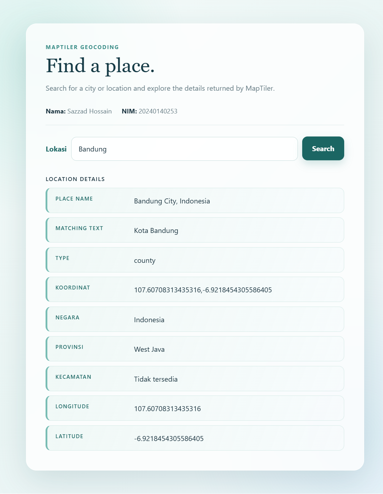

# 3NIMBelakang_WeatherApi

A browser-based geocoding interface built for the Web Service assignment. It uses the MapTiler API to search for a location and display geographic details.

## Features

- Search for a place by name
- Display the selected location
- Display country, province, and district
- Display longitude and latitude separately
- Display the place name
- Display matching text and geographical place type
- Responsive styling with Bootstrap 5.3.3 and a custom stylesheet

## Run Locally

Open `index.html` in a web browser, or serve the project with a local web server.

For example, with VS Code, use the Live Server extension and open `index.html`.

## Project Files

- `index.html` - Page structure and MapTiler API logic
- `style.css` - Custom page styling
- `README.md` - Project documentation

## Dependencies

The page loads these libraries from CDNs:

- jQuery 4.0.0
- Bootstrap 5.3.3
- MapTiler Geocoding API

## Assignment Checklist

- Repository name: `3NIMBelakang_WeatherApi`
- Minimum commit requirement: met locally with 5 commits
- API source: [MapTiler](https://api.maptiler.com/)
- Required outputs: location input, country, province, district, longitude, and latitude

## Screenshot

Successful browser result for a Bandung search:

The screenshot shows the completed search with the required geographic fields populated.

## Usage

1. Enter a city or location in the search box.
2. Select **Search**.
3. Review the returned place details.
